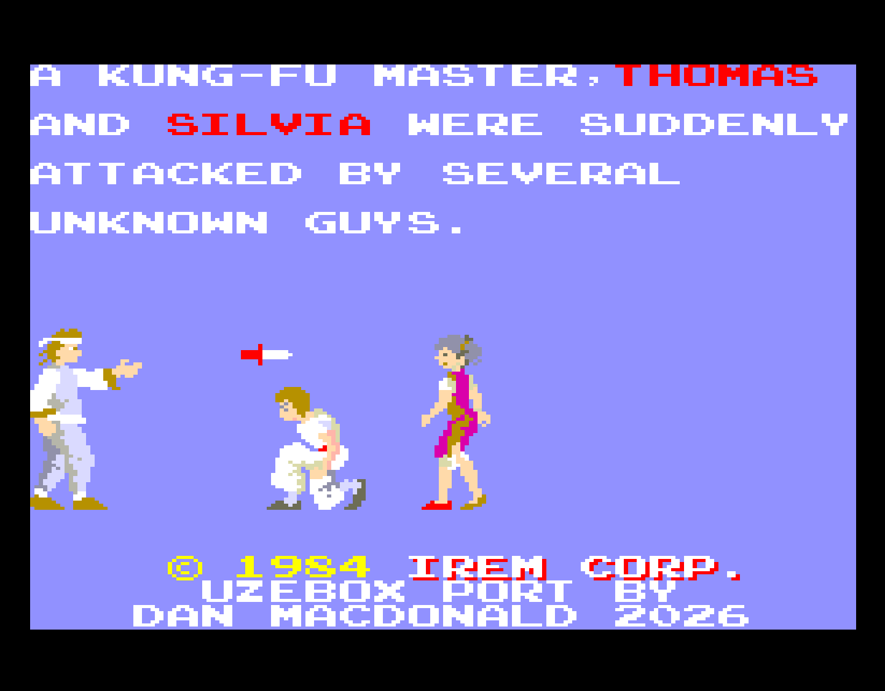
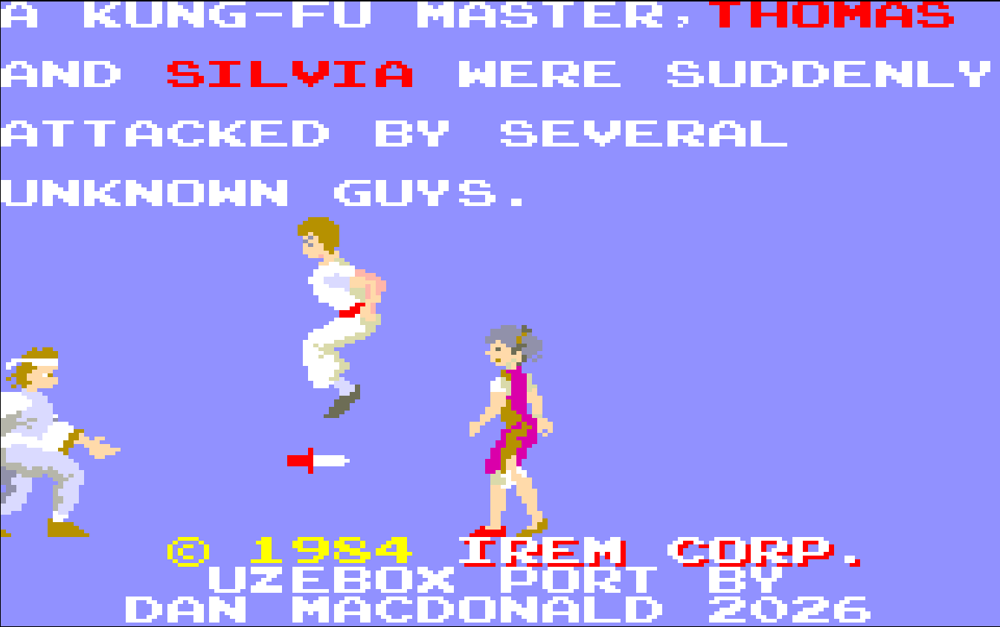

# Kung-Fu Master Uzebox port

A port of Irem's *Kung-Fu Master* (1984) to the Uzebox by Dan MacDonald using video mode 748 and the coding assistance of Claude Opus 5.5.





The custom 2 voice 2 bit ADPCM mixer and AY playback engine was contributed by Lee Weber aka D3thAdd3r.

Kung-Fu Master requires 128 KB SPI RAM to run.

The graphics, moves and sound are taken from **your own** arcade ROM set at build time; no ROM data is included here.

## Building

You need:

- **avr-gcc and avr-libc**;
- **the Uzebox repository** (its `kernel/` and a built `tools/packrom`), in `~/src/uzebox`, or passed as `UZEBOX=/path/to/uzebox`;
- **Python 3** with NumPy and Pillow;
- **the MAME ROM set `kungfum.zip`**. The set used in development has this SHA-256:

```
0a583b52503ce3aeef4698a0473bd5bc4c908503c4bbdb18886523a1da53ac22  kungfum.zip
```

```sh
make assets ROM=/path/to/kungfum.zip     # once (a minute or two): extracts, captures and builds the assets
make
```

`make` builds the game with the recommended options (sound, 168 lines). No `make clean` is needed: changing an option or rebuilding the assets rebuilds whatever depends on it.

Copy `_bin_/kungfum.uze` to the SD card: that one file is the whole game.

Everything under `build/`, `gen/`, `_obj_/` and `_bin_/` is derived from the ROM set. Don't distribute it; each user builds their own.

**The data is inside the `.uze`,** as in IK748 and stuntcar-uzebox:
- **The layout.** packrom writes its 512-byte header and the program; the Makefile pads that with zeros to a whole 512-byte sector and appends the game's data (`KFMG.DAT`, about 124 KB). The bootloader flashes only the program, whose size is in the header.
- **Loading.** At start-up the game opens its own `KUNGFUM.UZE`, checks the header's `UZEBOX` marker, skips the header and program to the next whole sector, and loads the data into SPI RAM from there.
- **The checksum.** `tools/kfm_pack.py` stamps the data's length and its CRC-16 (CCITT/XMODEM) into the data's header (bytes 16–21). The game computes the same CRC while copying the data, in the time each byte takes to go out to SPI RAM, which costs about 0.1 s.
- **The fallback.** If `KUNGFUM.UZE` isn't on the card (renamed, say), the game looks for a separate `KFMG.DAT` instead (`_obj_/KFMG.DAT`, stamped). Keep the `.uze`'s name for the single-file game.

Error screens at start-up:

| Colour | Error | Meaning |
|---|---|---|
| Red | 1 | The SD card did not initialise |
| Red | 2 | Neither `KUNGFUM.UZE` nor `KFMG.DAT` was found |
| Yellow | 3 | Bad SPI RAM data (no `KFM7` marker) |
| Cyan | 4 | The data is from another asset build than the program |
| White | 5 | The data is damaged: its CRC-16 or length is wrong |
| Magenta | 6 | No SPI RAM answered |
| Blue | 7 | The graphics blob is not where the build put it (a build fault) |

Build options:

| Option | Effect |
|---|---|
| `LINES=n` | The display height in lines (default 168). 168 is recommended: the floor and the characters' feet stay visible, with the floor's lower edge and the decorative base below it cropped, and every line taken off the display is blank time for drawing sprites. Measured in the emulator, sprites skipped for lack of time (and so flicker) fall from 391 at 184 lines to 183 at 176 and 57 at 168 in the knife throwers' stretch, and from 51 to 24 and 5 in the gripper pile-up. The story's credits end on the last row a 168-line display shows; the letter loses its bottom edge. |
| `SOUND=0` | The game without sound (default `SOUND=1`) |
| `GAME=0` | The sprite benchmark instead of the game (see the end of this file) |
| `UZEBOX=path` | The Uzebox source tree (default `~/src/uzebox`) |
| `INVINCIBLE=1` | Invincibility for practice: Select on the title or game-over screen turns it on and off (no damage, the timer stops; INV in the HUD) |
| `DEBUG=1` | The debugging aids: the statistics and diagnostics pages (Select in play), a crash log that survives a reset, and the SPI RAM self-check. Without it the game has one more RAM tile. |
| `EXTRA="-DKFM_VOLUME=n"` | 2 full volume (the default, the arcade's level), 1 half, 0 quarter |
| `EXTRA="-DKFB_SPI_PAD=n"` | Extra cycles before each of the sprite blitter's SPI RAM reads (default 1; 0 gave drawing errors on an Omega) |
| `EXTRA="-DKFM_FADE"` | The floor's music fades in over half a second |
| Test builds | See **Debugging and testing** |

## Controls

| Input | Action |
|---|---|
| Left / Right | Walk (and turn); shake off grippers |
| Down | Crouch |
| Up | Jump |
| B or Y | Punch (in a jump: a flying kick) |
| A or X | Kick (in a jump: a flying kick) |
| Start | Start a game / pause |
| Select | With `INVINCIBLE=1`, on the title or game-over screen: invincibility on / off. With `DEBUG=1`, in play: game HUD → statistics → diagnostics |

## Features

- **The intro:** the story typed out on two screens, and the kidnapping played back from the arcade's own sprites. After it comes the attract demo; on Start, the coin voice, the letter screen with the start jingle, and the walk-on (READY).
- **Floor 1:** the scrolling floor with the arcade's tiles and palettes, and the HUD (score, time, energy bars, lives).
- **Thomas:** the arcade's animations, captured frame by frame. He walks, crouches, jumps, punches and kicks (standing, crouching, flying), shakes off grippers, and dies with the arcade's fall and cry.
- **The right wall:** walking right at the start, the camera follows Thomas to its end, then he walks across the screen until he is up against the wall.
- **The grippers** walk in from both sides, grab and drain Thomas's energy. While the floor's right wall is on the screen, enemies come only from the left, as in the arcade.
- **The knife throwers** throw high and low knives with the arcade's timing; a knife that hits leaves the arcade's red strike. Beaten, they die as in the arcade: hit, stagger, and fall backwards through the floor.
- **The boss**, the stick fighter, appears in front of the stairs, with his laugh when he kills Thomas. As the arcade's, he keeps out of reach of Thomas's kicks, feinting with his staff, so ducking and kicking doesn't beat him: he comes in only to strike, and backs off if Thomas attacks first, so Thomas wins by dodging his thrust (crouch under a high one, jump a low one) and countering as he comes in. Each of his hits takes a quarter of Thomas's energy, as the arcade's (16 of its 63). Defeated, he falls; Thomas walks to the stairs and climbs them, and the floor clears with a time bonus.
- **Scoring:** the arcade's points and pop-ups (grippers: punch 200, kick 100; knife throwers: punch 800, kick 500), the timer ticking down, 3 lives, game over (with its jingle, then back to the intro) and pause.
- **When Thomas dies,** the enemies turn and walk off the screen.
- **Sound:** the arcade's sampled voices and effects, and the floor's music and jingles, rendered from the ROM's sound board.
- **Invincibility,** for practice (a build option: `INVINCIBLE=1`).

Not yet: floors 2 to 5, with their enemies and bosses.

## Third-party code (`third_party/`)

| Directory | What it is | Licence | Used by |
|---|---|---|---|
| `stearcade/` | Eight files of STEArcade (AnimaInCorpore): its Z80, its M6801/M6803, and the Kung-Fu Master board and sound board models | GPL v2 or later | `tools/kfm_extract.py`, `tools/kfm_capture.py`, `tools/kfm_intro_capture.py` and `tools/kfm_audio_build.py`, which run the user's ROM set on them |
| `kfa_mixer/` | The KungFuMasterAudio hand-off's 2-voice 2-bit ADPCM mixer and encoder, used with the author's permission | GPL v3 or later, through the Uzebox `dconvert` code it follows | The `SOUND=1` build and `tools/kfm_audio_build.py` |

Each directory has a `NOTICE.md` (origin, revision, files) and the licence text. The copies are unchanged; this port's adaptations are in `src/kfm_mixrt.c`, `src/kfm_mixvar.c`, `src/kfm_mix2.s` and `src/kfm_sound.s`. `STEARCADE=` and `MIXERS=` accept other copies.

**ROM data is never included.** That covers the ROM set itself and everything generated from it, including the sound clips.

## How it works

### The assets (`make assets`)

| Step | What it does |
|---|---|
| `tools/kfm_extract.py` | Boots STEArcade's reference machine to floor 1 and calls the game's own column generator (`$5765`) for each of the floor's 224 columns, which yields the whole floor map. Unpacks the ROMs under `build/rom/`. |
| `tools/kfm_capture.py` | Plays the reference machine with scripted and bot input, and records the sprites frame by frame: Thomas's moves and death, the grippers, the knife throwers (including their death), the boss, the knives and the score pop-ups. |
| `tools/kfm_intro_capture.py` | Records the arcade's intro: the story's screens, its typing, and the kidnapping's sprites. |
| `tools/kfm_build.py` | Fits the playfield and HUD palettes, converts the 329 floor tile/colour combinations to ROM tiles (with masks for the tiles the arcade draws over sprites), and writes the flash asset blob (`gen/`). |
| `tools/kfm_game_build.py` | Turns the captured poses into pre-shifted sprite streams in SPI RAM, with the moves' tables (`KFMG.DAT`, `gen/kfm_game.*`). |
| `tools/kfm_audio_build.py` | Runs the sound ROMs on STEArcade's sound board model (an M6803, two AY-3-8910s, two MSM5205s): the voices are resampled, the AY effects rendered, the music and jingles recorded as per-frame change streams. |
| `tools/kfm_intro_build.py` | Builds the intro's screen maps, typing lists and sprite playback. It places the story's sprites 1 px left and 1 px up of the arcade's positions, and checks the rows the story's row layout depends on (see **Display**). |
| `tools/kfm_pack.py` | (in `make`) Stamps the data's length and CRC-16 before it goes into the `.uze`. |

### Memory

- **Flash:** the program, then the asset blob (tiles, palettes, masks) at 0x8C00. Everything ends below 0xE000; `kfm_build.py` refuses a blob that would go past it. Some Uzebox bootloaders keep data above 0xE000, and writing there corrupted an Omega's bootloader font.
- **SPI RAM (about 124 KB of 128 KB):**
  - **bank 0:** the floor and HUD maps, the knife thrower's death poses, the sound clips, the music and jingles, and the intro;
  - **bank 1:** the game's poses.
- **SRAM:** what is left after the program's variables is RAM tiles for the sprites: at 168 lines, 60 in play (59 with `DEBUG=1`), and 72 during the story (taller displays need more playfield rows, so they have fewer tiles). The story is silent, so it borrows memory the game isn't using then: the sound queue's page above the tiles (7 tiles), and below them the enemies and the effect voices (5 tiles; at 184 lines also a spare playfield row, for 6). These three sit together at the end of RAM in `.noinit`; the Makefile moves the mixer's voices there with `objcopy`. Select's sound during the story, the demo and the letter each get the memory back first, cleared.

### Display

Mode 748 at 192 pixels wide: two HUD rows at the top, a separator line that loads the playfield palette, then the playfield (arcade x 32–223). The intro uses the same rows with its own row table and palette.

In the story, screen row 1 is one plain colour on both screens and never has a sprite, so it is drawn by a 4-byte single-colour row (Mode 748's mode 2). The last row (22), which has no sprites either, takes row 1's row structure, which frees the last playfield row for the RAM tiles. `tools/kfm_intro_build.py` checks both rows against the ROM's data, and the story keeps every row if they don't qualify.

### Sprites

The sprites are drawn by a blitter written for this game (`src/kfb.s`, `kfb_pose()` in `src/main.c`), 2.5–2.7× faster than Mode 748's own:
- **Data.** Each pose is composed at build time into one stream in SPI RAM, stored twice, pre-shifted for even and odd x. A flip reuses the same data, with swapped nybbles and a reversed write order.
- **Allocation.** A per-pose table gives, for each vertical phase, the tile columns each 8-line band touches. An assembly routine (`kfb_alloc`) allocates exactly those RAM tiles, reusing any already allocated. It fills new ones from their ROM tiles, or with a constant when the build tool has marked a ROM tile as one flat colour, and skips foreground tiles.
- **Streaming.** The pose is then one SPI burst, each byte's transfer overlapped with a masked write, at 18 cycles per byte (two pixels).
- **Deadline mode.** In play, a pose that won't fit in the blank time left is skipped for a frame instead of drawn late, using a per-pose cost estimate. That keeps 60 Hz but makes busy scenes flicker. The estimate counts only the RAM tiles a pose still needs, with costs fitted to the worst case measured in the two busiest scenes, so it skips little that would have fit. A bug that costed every pose's tiles at about 30 lines (the real cost is 1–6) was fixed. Measured in the emulator, the fix cut the poses skipped from 407 to 68 in 1,200 frames of the gripper pile-up and from 1,047 to 394 in 900 frames of the knife throwers, with no drawing running into the display. The story draws every sprite.
- **The story's grippers.** The arcade has three grippers walking in to take Sylvia, but the RAM tiles hold two. `tools/kfm_intro_build.py` follows each gripper from frame to frame and keeps the same two drawn while they are on the screen. (Taking the first two in the arcade's sprite list, which puts the newest first, swapped them whenever a third came on, and the left one seemed to jump back as they walked in.)
- **Draw order.** When RAM tiles run out, whatever is drawn last loses its lower rows. In play, the knife throwers and the boss, the largest sprites, are drawn first, so the shortage falls on the grippers. In the story the knives are drawn first, then the rest in the arcade's order.
- **The story's grid alignment.** How many RAM tiles a character needs depends on how it lines up with the 8×8 grid. The story's background is flat, so its sprites are drawn 1 px left and 1 px up of the arcade's positions, which can't be seen; of the 64 alignments, that one needs the fewest tiles. Together with the 71 tiles, it took the intro from 1,112 cells dropped in 146 frames to 4 in 3 frames (measured in the emulator).
- **Verification.** `tools/verify_blit.py` reads the VRAM rows and RAM tiles back from the emulator, rebuilds every cell Thomas covers in Python, and compares them byte for byte: exact across both facings and every x alignment.

### Sound (`SOUND=1`)

- **The effects** use the KungFuMasterAudio hand-off's 2-voice 2-bit ADPCM mixer (`pcm_adpcm2_2v`). Its per-sample work is in assembly (`src/kfm_mix2.s`): the same values as the hand-off's C, in about half the time (`C_MIXER=1` builds with the C instead). It decodes in the foreground into a 256-byte queue at SRAM 0x0E00, topped up only while there is safe time before the display.
- **The per-line routine.** `src/kfm_sound.s` replaces the kernel's `update_sound` and plays one queued sample a line. It also generates the music: two square-wave tone channels and the drums' noise, from the arcade's AY channels. It keeps the stock inline mixer's exact cycle contract (SYNC edges at 62 and 129 cycles, 189 in all), checked by a static walk of every path through its disassembly. The kernel's own sound engine is not linked; `src/kfm_nokernsnd.s` stands in for what the kernel's core refers to.
- **The music** is read once a frame from per-frame change streams in SPI RAM. It keeps its own time from the vertical sync's frame count, catching up on late frames, and stays out of the vertical sync.
- **The story is silent,** as the arcade's attract mode, so it borrows the queue's page and the effect voices as more RAM tiles (see **Memory**). Select's sound during the story hands them back for a moment.

What plays:

| Sound | Arcade command |
|---|---|
| Thomas's shout (every attack) | $02 |
| Thomas hurt | $03 + $11 |
| A hit landing | $11 |
| A knife thrown | $15 |
| Thomas's death cry | $07 |
| The boss's laugh, when he kills Thomas | $04 |
| The coin voice, on Start | $01 |
| A footstep (READY) | $10 |
| The start jingle; the game-over jingle | $20; $21 |
| The floor's music | $24 |

### Robustness

- **Padded SPI RAM access.** Everything except the sprite blitter, which pads its own reads, uses `src/kfs.s`, which waits about 31 cycles after each byte. On an Omega, minimum-timing HUD writes sometimes went to the wrong address.
- **Display self-repair.** Every frame the game checks the display's row structures in SRAM (tile windows, HUD rows, row selector, separator) and repairs any that differ.
- **Firmware and data must match.** Each asset build writes a random build ID into the data and the firmware; a mismatch stops at the cyan screen. (With the data packed into the `.uze`, the two always match; the check guards the `KFMG.DAT` fallback.) The music player also stops on anything that isn't music data.
- **Unexpected interrupts.** The game switches off the UART, external and pin-change interrupts at start-up. A catch-all handler replaces avr-libc's default jump to address 0: it switches them off again and counts the event (`I` on the diagnostics page). A Uzenet ESP8266 sends its serial output to the AVR's UART.

## Debugging and testing

### `DEBUG=1`

Select in play cycles the HUD: game → statistics → diagnostics.

**Statistics** (updated once a second):

```
CPU 043/046 MAX 048 U37
RT 46/58 MISS 264 ...
```

- **`CPU`:** the average scanlines of CPU time an update took in the last second, out of the blank lines available per frame. **`MAX`:** the worst in that second. **`U`:** updates per second.
- **`RT`:** RAM tiles used by the last update, out of those available. **`MISS`:** cells per second left undrawn because the RAM tiles ran out.
- The rest of the row is the benchmark's settings.

**Diagnostics:**

```
BOOT nnnn Zxx Pnnn Lnnnn
STKnnn Pn Tnnnn Inn Snn
```

- **`BOOT`:** how many times the program has started (kept in EEPROM, if it is formatted; the program never formats it).
- **The crash log.** A few bytes at a fixed address that a reset leaves alone, read back at the next start-up. They describe the run before the reset; `NONE` means none survived.
  - **`Z`, `P`, `L`:** where the per-line sound routine last was: its call flags, the sync position, and the lines since the main loop last came round. Without a crash log, the first row shows SPI RAM self-check errors (`SPI`) and the last address the display self-repair fixed (`@`) instead.
  - **`P`:** the phase the game was in: 1 game logic, 2 drawing Thomas, 3 drawing the enemies, 4 after drawing, 5 the HUD, 6 waiting for the display, 7 the SPI RAM self-check, 8 the sound.
  - **`T`:** the seconds it ran.
  - **`S`:** its lowest free stack, measured at the next start-up from what is left of its stack paint (0: the stack overflowed).
- **`STK`:** this run's lowest free stack above 0x1020, below which Mode 748 keeps its own data.
- **`I`:** unexpected interrupts this run.

### Test builds

Several of these came from chasing resets on an Omega that turned out to have a hardware fault; they remain useful for narrowing down a problem.

| Option | What it does |
|---|---|
| `EXTRA="-DKFM_BOOT_DIAG"` | No intro: the game starts at once on the diagnostics page, so the crash log of the run before a reset is on screen straight away (implies `DEBUG=1`) |
| `EXTRA="-DKFM_NO_MUSIC"`, `"-DKFM_NO_SFX"` | Effects only; music only |
| `EXTRA="-DKFM_NO_FILL"` | No sound queue refill |
| `STOCK_ISR=1` | The kernel's own per-line routine instead of `kfm_sound.s` (silent; the rest of the sound runs) |
| `QUEUE=0x0D00` | The sample queue's page (default 0x0E00) |
| `C_MIXER=1` | The hand-off's C mixer instead of the assembly one |
| `EXTRA="-DKFG_NO_HUD"`, `"-DKFG_NO_CHK"`, `"-DKFG_NO_ENEMIES"` | No HUD writes in play; no SPI RAM self-check; Thomas alone |
| `NOSOFTRESET=1` | The kernel's controller code without its Start + Select + Y + B restart into the bootloader |
| `EXTRA="-DKFB_PROFILE"` | The pose and allocator functions out of line, for timing with breakpoints |
| `EXTRA="-DKFB_FIXED_DEADLINE"` | Deadline mode with a fixed 16-line threshold instead of the cost estimate |

### In the emulator

The test tools run [cuzebox-ex](https://github.com/weber21w/cuzebox-ex) headless through its TCP API: set `CUZEBOX=` to its `cuzebox`, or build it in `../cuzebox-ex`.

- `tools/play_test.py --script "start*4;*30;left*900:a/16" --shots 300,600 [--cam N]` plays the game with scripted input.
- `tools/run_test.py --frames 600 --grips 6` measures the benchmark build (below).
- `tools/verify_blit.py [--right]` checks the blitter's output byte for byte (benchmark build).

## The sprite benchmark (`make GAME=0`)

The measurement prototype the port grew from: floor 1 scrolling under joypad control or autoplay, Thomas's walk and up to six grippers, with no game logic. It builds `_bin_/kfm748.uze`, which loads a separate `_bin_/KFM.DAT`; copy both. Its controls:

| Button | Action |
|---|---|
| Select | Number of grippers: 0, 1, … 6, then back to 0 |
| Start | Autoplay on / off. With autoplay off, Left and Right walk |
| A | Blitter: Mode 748 (`M`) → custom with the C allocator (`C`) → custom with `kfb_alloc` (`A`) |
| X | Deadline mode on / off (`D`) |
| B | HUD page: statistics → diagnostics → arcade panel |

The settings are kept in EEPROM. The statistics row ends with the blitter letter, `P` (autoplay) or `J` (joypad), and `D`.

Measured during development, CPU lines per update and updates per second, at 192 lines:

| Load | Mode 748 blitter | Custom, C allocator | Custom, `kfb_alloc` |
|---|---|---|---|
| Thomas | 37.3 (60/s) | 18.0 (60/s) | **14.3 (60/s)** |
| Thomas + 2 grippers | 65.0 (53/s) | 30.7 (60/s) | **24.2 (60/s)** |
| Thomas + 4 | 91.0 (34/s) | 41.5 (60/s) | **33.7 (60/s)** |
| Thomas + 6 | 113.9 (30/s) | 51.1 (60/s) | **41.9 (60/s)** |
